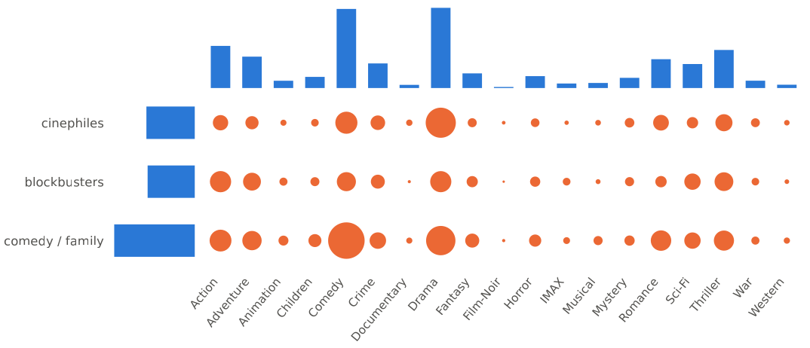
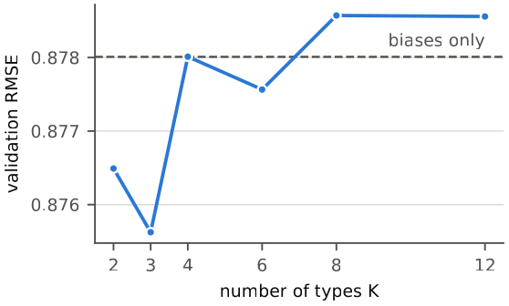
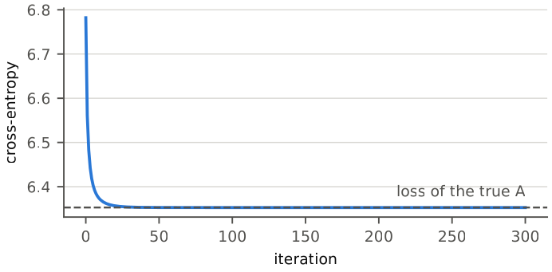
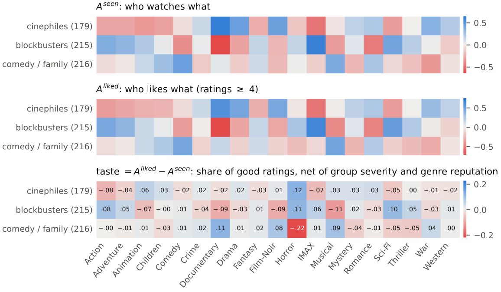
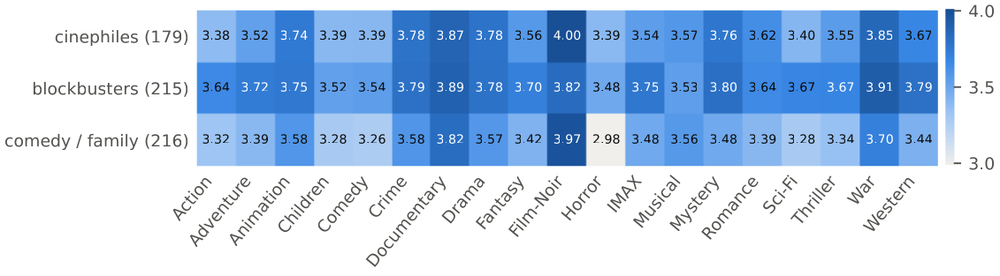

# Inverse optimal transport for collaborative filtering

Predicting missing movie ratings on MovieLens with inverse optimal transport (IOT, Li et al., 2019). Users are grouped into types, IOT learns the affinity between each type and each movie genre, and that affinity enters a bias model as a taste variable.

Group project for the DataLab course of the Master IASD (Université Paris Dauphine – PSL), October 2026, with Baudouin de La Ville de Baugé and Enzo Jarmoszko. This repository contains my part: the IOT implementation and the rating model built on it.



*Observed coupling between the three user groups and the 19 genres. Circle area: number of ratings from a group on a genre. Bars: marginals, ratings per genre (top) and per group (left).*

## Approach
1. **Types.** Users are clustered by k-means (K = 3) on the share of each genre among the films they rated. Films are described by their 19 MovieLens genres; a film with g genres counts 1/g in each.
2. **Couplings.** Two tables of size K × 19 count the ratings between user type k and genre l: all ratings ("seen") and ratings ≥ 4 only ("liked"). Each is normalised into an observed coupling π̂.
3. **IOT.** For each table, the interaction matrix A is learned so that the entropic optimal transport plan with cost C = −A and the empirical marginals fits π̂ by maximum likelihood, with a ridge penalty on A. Sinkhorn runs in the log domain.
4. **Taste.** A_liked − A_seen gives each type's taste for each genre, net of the type's severity and of the genre's reputation.
5. **Ratings.** rating = μ + b_user + b_film + β · taste(type of the user, genres of the film), fitted by alternating least squares with shrunk biases.

K, the ridge on A, the "liked" threshold and the bias shrinkage are chosen jointly on an internal 80/20 validation split of the training ratings.



*Internal validation RMSE as a function of the number of types K; the dashed line is the model without taste. K = 3 is retained.*

The IOT implementation is checked on simulated data: couplings drawn under a known A, then A learned back. The loss reaches that of the true A (`python src/iot.py` runs this check).



## Results
On the 31,598 test ratings of the course split. Accuracy counts exact ratings after rounding the prediction to the nearest half point.

| Model | RMSE | Accuracy |
|---|---|---|
| Global mean | 1.0369 | 12.89 % |
| User and film biases | 0.8746 | 24.46 % |
| Matrix factorisation (ALS, implemented by a teammate) | 0.8738 | 24.49 % |
| **Biases + IOT taste, K = 3** | **0.8734** | **24.52 %** |



*The maps of the retained model, 3 groups × 19 genres. The k-means groups are named after the genres they watch most: cinephiles, blockbusters, comedy / family (number of users in brackets).*



*Expected mean rating per cell (group, genre), from the plan learned on rating-weighted counts divided by the plan learned on rating counts.*

The IOT model matches a tuned matrix factorisation while remaining fully readable: three groups and a 3 × 19 taste map. The gain over the biases alone is small (0.0012): most of the signal lies in the individual biases, and a taste shared by a whole group only corrects a few tenths of a point. The transport framework is also mostly formal here, since a film has no capacity: the model is a log-linear interaction model on a contingency table, fitted by Sinkhorn.

## Repository
```
generate.py         completes a ratings matrix (course interface: --name, writes output.npy)
evaluate.py         RMSE and accuracy on held-out ratings
src/iot.py          log-domain Sinkhorn and IOT; run it for a simulation check that recovers a known A
src/types_iot.py    types, couplings, rating model, validation grid, heatmaps of the learned maps
src/genres.npz      genres of the 4,980 films, extracted from MovieLens
figures/            figures of this README
```
Code comments are in French.

## Running
```
pip install -r requirements.txt matplotlib
python generate.py --name data/ratings_train.npy
python evaluate.py
python src/types_iot.py
python src/iot.py
```
The ratings (`data/ratings_train.npy`, `data/ratings_test.npy`: 610 users × 4,980 films, NaN for missing ratings) are the course's train/test split of MovieLens Latest Small and are not redistributed here.

## References
- R. Li, X. Ye, H. Zhou, H. Zha. *Learning to Match via Inverse Optimal Transport.* Journal of Machine Learning Research 20(80), 2019.
- F. M. Harper, J. A. Konstan. *The MovieLens Datasets: History and Context.* ACM Transactions on Interactive Intelligent Systems 5(4), 2015.

## Credits and data
- The matrix factorisation baseline and the project report (joint work) are not included. The figures come from the report.
- `generate.py` follows the interface of the course starter repository ([AlexVerine/DataLabAssignement1](https://github.com/AlexVerine/DataLabAssignement1)).
- MovieLens data © GroupLens Research, University of Minnesota, used under its terms of use (no commercial use; see [grouplens.org](https://grouplens.org/datasets/movielens/)). `src/genres.npz` is derived from it and distributed under the same conditions.
